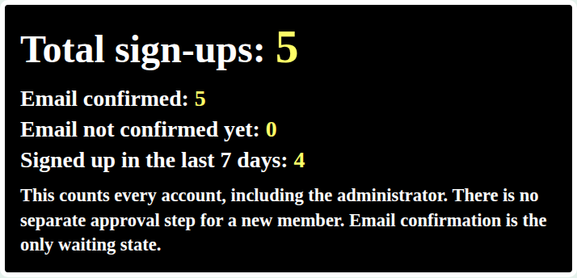
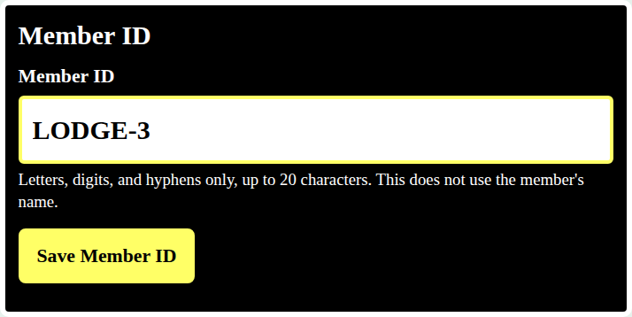
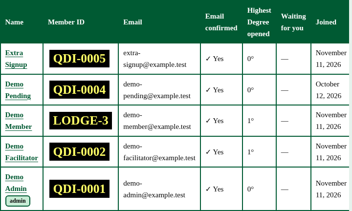
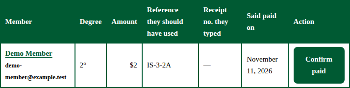
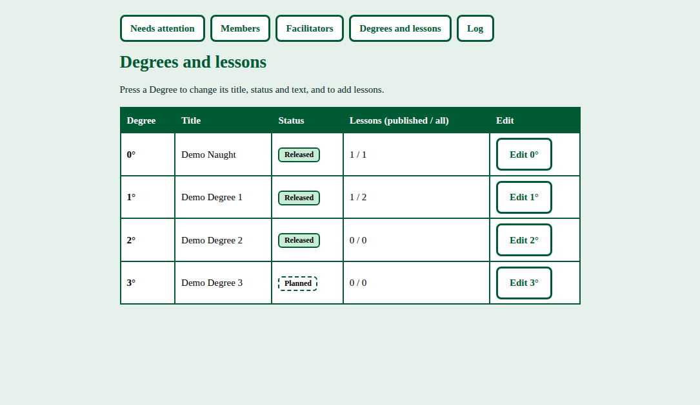
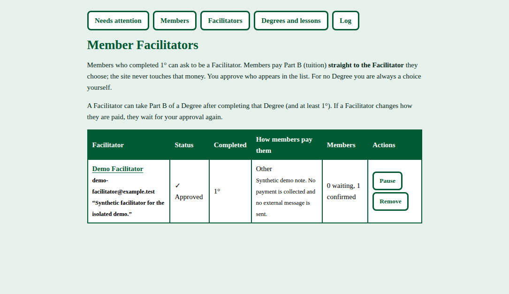

# Ken's admin guide

Read this in large type. Every step below is for the members area after you are signed in as the administrator. The pictures are from the local demo, not from the live site.

Sign in with the admin email and password. Then press **Admin**.

## See how many people have signed up

The black box at the top of Admin says **Total sign-ups**. Under it are three more numbers: email confirmed, email not confirmed yet, and signed up in the last 7 days.

The same box is at the top of **Members**. A normal member does not see it.

## Assign a Member ID

1. Press **Members**.
2. Press the person's screen name.
3. The black box says **Member ID**. Type the ID you want. Use letters, digits, and hyphens, up to 20 characters.
4. Press **Save Member ID**.

A new sign-up already has a placeholder such as `QDI-0007`. That placeholder does not contain their name. You can replace it. If the ID is already used, the page tells you, and the old ID stays.

The Members list shows each ID in yellow on black.

Old IDs that were built from names are left as they are. To change only those, and only when you choose, see the move checklist. Do not run that on the live site until you have a backup.

## Confirm a payment

The site does not hold the money. A member pays through PayPal, or pays a Facilitator, and then says so on their Degree page.

The dollar amounts members should pay are in the Curriculum section of the main site. Ken changes them there. The amount stored on each Degree must match that section, because a PayPal link uses the stored amount. The pages members read point them to the Curriculum section instead of printing a dollar figure.

The payment page also tells members to pay from a PayPal Business account named with an alias, so their real name stays private. Ken tested this with an account named Bro. Ken.

1. Open **Admin**.
2. Under **Members who say they paid Part A**, find the person.
3. Check your own PayPal for the reference code on that row.
4. When the money has arrived, press **Confirm paid**.

Part B works the same way when the member is paying you. If they are paying a Facilitator, that Facilitator confirms it. You can still confirm it yourself.

After you confirm Part A, the lessons for that Degree open for that member. A lesson marked as a draft stays hidden. The next Degree stays locked until Part B of this one is confirmed, and until any waiting days are over.

## Add or edit a Degree

1. Press **Degrees and lessons**.
2. Press the Degree number.
3. Set the title, the short description, Part A, Part B, and the waiting days.
4. Press **Save**.
5. To add a lesson, press **Add a lesson** on that Degree. Give it a title. Tick **Published** when members should see it. Leave it unticked to keep a draft.

## Facilitators

1. Press **Facilitators**.
2. A person who has asked to be a Facilitator is listed there.
3. Read how they want to be paid. Press **Approve** when you are satisfied, or leave them waiting.

The site never collects Part B. It only records that the member says they paid, and that you or the Facilitator confirmed it.

## If something looks wrong

Press **Log**. It lists what administrators and members did, such as a payment confirmation or a Member ID change. It does not show passwords.
